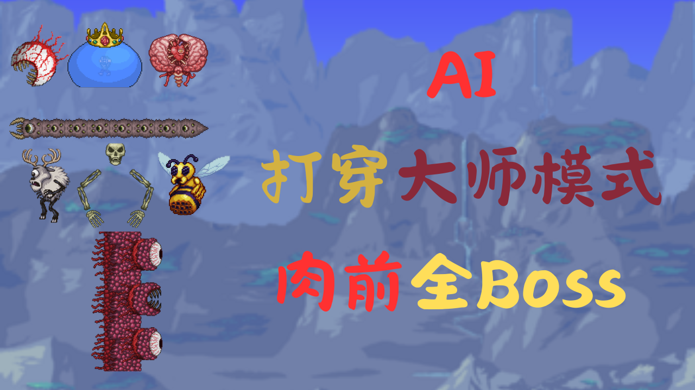
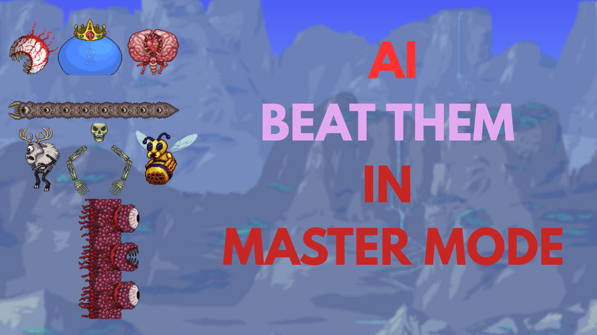
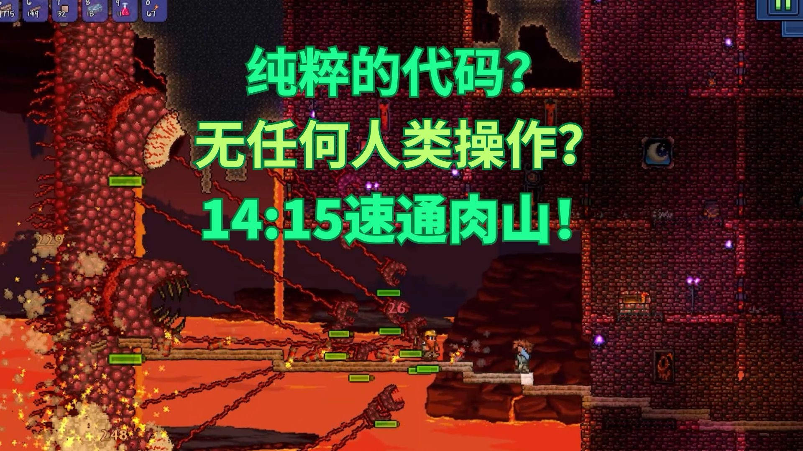
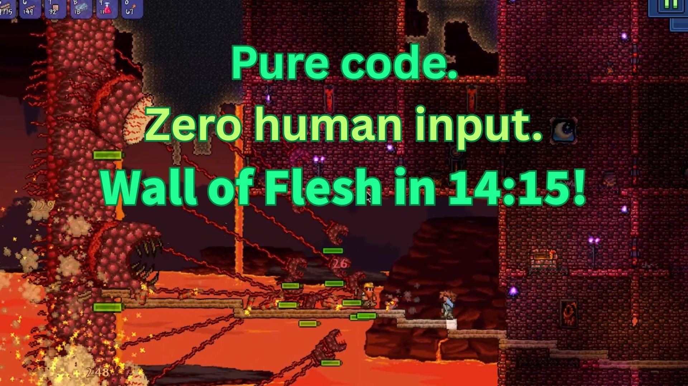

# TerraBlind

[中文](#中文) · [English](#english)

**让 AI 在真实游戏中理解目标、作出判断，并持续行动。**

TerraBlind 是一个以 Terraria 为载体的实时游戏 Agent 项目，运行于 tModLoader。LLM 负责规划、调查和编写行为脚本，Jev 负责快速情境判断，游戏执行层负责感知、寻路、瞄准与逐帧操作。

**An AI agent that plans, decides and acts in a live game.**

TerraBlind uses Terraria as an environment for building a real-time game agent. An LLM plans and writes executable behavior, Jev makes fast contextual decisions, and the game runtime handles perception, navigation, aiming and frame-level control.

 

## Demo

**Jev 驱动的 Boss 战 / Jev-driven boss fights**

|  |  |
|:---:|:---:|
| [哔哩哔哩](https://www.bilibili.com/video/BV1Boe26JEh4/) | [YouTube](https://www.youtube.com/watch?v=g6CADbjBhlk) |

**早期纯代码流程：击败肉山 / Earlier code-only Wall of Flesh run**

|  |  |
|:---:|:---:|
| [哔哩哔哩](https://www.bilibili.com/video/BV1PmbP6ZEJc/) | [YouTube](https://www.youtube.com/watch?v=5fHr4ESr6os) |

早期固定流程从 `/start` 到击败肉山，用时14分15秒（三倍速）。该演示的辅助设置见下文。

The earlier fixed pipeline takes 14 minutes 15 seconds at 3× speed. Its assistance settings are described below.

---

## 中文

### 我们在解决什么

模型思考需要时间，游戏世界每一帧都在变化。TerraBlind 探索的是：**如何让耗时的高层推理，驱动连贯、及时、能处理变化的实时行动。**

玩家通过自然语言给出目标，例如去丛林收集资源、制作装备，再准备一场 Boss 战。Agent 调查世界与配方，建立任务依赖，编写可执行策略，在行动过程中继续观察和调整。

当前重点是行动的连贯性、现场判断和执行效率。复杂长任务的稳定性、生存和失败恢复仍在迭代。

### 三个部分如何协作

| 部分 | 职责 | 具体做什么 |
| --- | --- | --- |
| **LLM Agent** | 理解目标、规划和改写策略 | 查询配方、物品与 Wiki；拆解任务；编写 JavaScript；准备后继和恢复脚本 |
| **Jev 决策模型** | 根据现场快速作出类型化判断 | Boss 走位；局部移动与武器选择；通过脚本接入沿途机会、路线和战术判断 |
| **游戏执行层** | 持续执行、测量与验证 | 感知世界；导航与物理推演；挖掘、放置、拾取、瞄准；输入交接与结果核验 |

~~~mermaid
flowchart TD
    User[自然语言目标] --> Agent[LLM Agent：调查与规划]
    Agent --> Plan[DAG：前置依赖与完成条件]
    Plan --> Script[JavaScript 策略与技能]
    World[真实游戏状态] --> Agent
    World --> Jev[Jev：现场判断]
    Jev --> Script
    Script --> Runtime[执行层：持续操作与逐帧控制]
    Jev --> Runtime
    Runtime --> World
    World --> Verify[宿主：验证实际结果]
    Verify --> Plan
    Verify --> Agent
~~~

**慢循环**调查未知、修改计划和准备策略。**快循环**在游戏内执行已经准备好的行为，处理事件，并使用 Jev 判断现场选择。模型准备下一步时，当前后台动作可以继续运行；已保存的后继脚本由宿主按依赖与验收结果调度。

### Agent 写代码来玩游戏

Agent 通过 `run_script` 执行 JavaScript，用 `tool(...)` 组合游戏能力。策略里可以有循环、条件、库存检查和事件处理，例如边赶路边关注附近资源，完成一段采集后继续下一项。

这是一种 **Code as Policies** 的思路：模型把行为写成在游戏里运行的程序，再根据新事实修改它。

已有的执行机制包括：

- **任务 DAG**：表达共享前置、依赖和完成条件，按真实库存、永久生命、装备、位置、击杀等状态验收。
- **后台动作**：以句柄查询、暂停和续接导航、采集或战斗，保留原任务与进度。
- **途中反应**：用 `on(...)` 注册现场处理；用 `task_policy` 让策略覆盖整项任务。
- **技能库**：通过 `script_program` 保存、读取和修订 JavaScript，以 `skill(...)` 复用。
- **恢复证据**：保留失败参数、执行结果和现场状态，供 Agent 核对与调整。

目标完成由宿主读取游戏状态验证。详细接口见 [Agent/README.md](Agent/README.md)。

### Jev 如何参与战斗

[Jev](https://docs.typesafe.ai) 是 TypeSafe 的 System One 模型。这里用它在结构化候选中作出选择，执行代码把选择落实成游戏操作。

Boss 战的输入包含玩家与 Boss 状态、部件、弹幕、运动方向、地形边界和当前可用动作。移动选择表达**方向及水平、竖直幅度**，由当前装备对应的执行方式支撑，例如普通移动、跳跃、二段跳、钩爪或坐骑。瞄准、动作时序和可用性检查由执行层处理。

Boss 策略文本位于 [Jev/Fight/BossBook.cs](Jev/Fight/BossBook.cs)，可通过配置中的 `BossPlaybook` 调整。上方视频展示了 Jev 在大师模式肉前 Boss 战中的表现。

普通战斗与 PvP 也有移动、射界、武器和弹道处理。Agent 的 JavaScript 可通过 `jev_judge` 接入快速判断；候选移动可结合物理推演，并在执行前复核当前状态。

### 开始使用

当前开发目标为 Terraria 1.4.4.9 对应的 tModLoader。

1. 安装 Terraria 与对应版本的 tModLoader，启用 TerraBlind。
2. 在模组配置的“内置 Agent”中选择后端：本机 **Codex**，或支持工具调用的 **OpenAI 兼容 API**。
3. 使用 Jev 时配置 **TypeSafe API Key**，并开启所需的战斗功能。
4. 进入世界，在聊天框输入 `/tb` 指令。

~~~text
/tb 帮我制作一个工作台
/tb 去丛林寻找生命水晶，顺路搜刮箱子
/tb /goal 收集材料制作荆棘旋刃，然后召唤并击败蜂王
/tb /goal status
/tb /goal pause
/tb /goal resume
/tb stop
~~~

这些是任务输入示例，复杂任务的完成情况取决于装备、世界与当前执行能力。`/goal` 保存长期目标，宿主按任务状态调度后续执行。

Codex 后端由 mod 自动启动本机 `codex app-server`。API 后端在配置中填写 Key、Base URL 和模型名。后端配置、AI 玩家绑定及工具说明见 [内置 Agent 文档](Agent/README.md)。

Jev Key 的读取顺序是：模组配置 → 仓库根目录 `.env` → 环境变量 `TYPESAFE_API_KEY`。参考 [.env.example](.env.example)。

### 早期固定流程：速通肉山

`/start` 是项目早期手工编排的流程：建房 → 前往丛林并寻找下降路线 → 沿途采集 → 地狱搭桥与建房 → 引入 NPC、购买雷管 → 挑战肉山。在种子 `1.1.2.38154567` 上完成过完整演示。

该流程的早期演示使用了常驻鱼鳃与光芒、木材补给、部分岩浆与交互范围辅助，以及 [DragonLens](https://github.com/ScalarVector1/DragonLens) 的关闭刷怪、无敌和倍速功能。相关配置与修改应随演示一起披露。

### 开发与验证

源码放在 `tModLoader/ModSources/TerraBlind/`。独立开发客户端可使用：

~~~sh
dotnet run --project tests/Agent/AgentTests.csproj
python3 scripts/dev_client.py build --role agent
python3 scripts/dev_client.py run --role agent
~~~

脚本输出独立保存目录、日志位置和 HTTP 端口。普通客户端默认接口地址为 `http://127.0.0.1:17878`，独立 Agent 客户端默认端口为 `17879`。

验证分为独立逻辑检查、真实引擎场景和完整实机任务。任务效果同时看完成结果、停留时间、受伤与死亡、动作衔接和模型调用开销。

| 目录 | 内容 |
| --- | --- |
| `Agent/` | 模型后端、任务 DAG、脚本运行时、技能、事件观察与恢复 |
| `Jev/` | 决策模型、Boss 策略、快速战斗判断和显示 |
| `Perception/` | 游戏状态、地形观测、物理状态与推演 |
| `Nav/` | 导航、移动规划、执行衔接与生存辅助 |
| `Actions/` | 挖掘、放置、使用物品、合成等动作 |
| `Flow/`、`Build/` | 固定流程、战斗协调与建造 |
| `Infra/`、`Debug/` | HTTP 接口、配置、日志和调试显示 |

常用日志：`TerraBlindLogs/latest/jump_trace.log` 为主时间线，`events/` 按类别记录，`runs/` 保存单次导航现场。`/vis on`、`/vis off` 控制调试图层。

更多资料：[Agent 文档](Agent/README.md) · [能力清单](CAPABILITIES.md) · [搭桥边界情况](docs/BRIDGE_CASES.md)

项目全程使用 AI 编程工具辅助开发；需求定义、方案审查、方向调整与实机测试由作者负责。

### License

MIT

---

## English

### The problem

Model reasoning takes time while a live game keeps changing every frame. TerraBlind explores **how slower planning can drive continuous, timely action that adapts to the situation**.

A player gives a natural-language objective. The agent investigates the world and recipes, plans dependencies, writes executable behavior, and observes and revises it during execution. The current focus is continuity, contextual decisions and efficiency. Reliability, survival and recovery in complex tasks remain under active development.

### Architecture and Code as Policies

| Component | Responsibility |
| --- | --- |
| **LLM agent** | Understand objectives, query knowledge, build task DAGs, write JavaScript, prepare successors and recovery |
| **Jev decision model** | Make fast typed choices for boss movement and script-driven local tactics, weapons and opportunities |
| **Game runtime** | Observe the world, navigate, forecast movement, mine, place, collect, aim, coordinate input and verify outcomes |

The slow loop investigates and prepares behavior. The fast loop executes prepared behavior inside the game and handles local events. Background actions can keep running while the agent prepares changes; the host schedules saved successors after checking their prerequisites and completion conditions.

The agent uses `run_script` to execute JavaScript, composing game capabilities through `tool(...)`. Programs can contain loops, conditions, inventory checks and event handlers. The runtime provides task DAGs, background action handles, `step(...)` checkpoints, `on(...)` reactions, task-wide policies and a versioned JavaScript skill library.

Failed actions retain evidence for inspection and recovery. The host verifies task completion against actual game state. See [Agent/README.md](Agent/README.md) for the interfaces and configuration.

### Jev-driven combat

[Jev](https://docs.typesafe.ai) makes choices from structured candidates. Boss observations include the player, boss parts, projectiles, motion, terrain boundaries and available actions. Movement decisions express a direction and a magnitude for each axis; execution uses the available movement abilities and equipment. Code handles aiming, timing and availability checks.

Boss instructions live in [Jev/Fight/BossBook.cs](Jev/Fight/BossBook.cs) and can be adjusted through `BossPlaybook` in the mod config. The video above demonstrates Master-mode pre-Hardmode boss fights.

Ordinary combat and PvP also include movement, line-of-fire, weapon and projectile handling. Agent scripts can call `jev_judge` for contextual decisions, combine candidates with movement forecasts, and revalidate before execution.

### Getting started

The current development target is tModLoader for Terraria 1.4.4.9.

1. Install Terraria, the matching tModLoader version and TerraBlind.
2. Configure the built-in agent to use local **Codex** or an **OpenAI-compatible API** with tool calling.
3. Set a **TypeSafe API Key** and enable the desired combat features for Jev.
4. Enter a world and send `/tb` commands in chat.

~~~text
/tb Craft a workbench for me
/tb Explore the jungle for life crystals and loot nearby chests
/tb /goal Gather materials, craft a Thorn Chakram, then summon and defeat Queen Bee
/tb /goal status
/tb /goal pause
/tb /goal resume
/tb stop
~~~

These are task examples; complex-task results depend on the world, equipment and current execution capabilities. `/goal` retains a long-running objective for host scheduling.

The mod starts local `codex app-server` for the Codex backend. The API backend uses the configured key, base URL and model name. Configuration and AI-player binding are documented in [Agent/README.md](Agent/README.md).

Jev reads its key from the mod config, then the repository `.env`, then `TYPESAFE_API_KEY`. See [.env.example](.env.example).

### Earlier code-only milestone

`/start` runs a fixed pipeline: build housing, descend through the jungle, collect resources, build an Underworld bridge and housing, obtain dynamite, and defeat the Wall of Flesh. The recorded run used seed `1.1.2.38154567` and took 14 minutes 15 seconds at 3× speed.

That demonstration used Gills and Shine, wood supplies, selected lava and interaction-range assistance, and DragonLens settings for disabled spawns, invincibility and fast-forward. These settings belong with the demonstration results.

### Development

Place the source in `tModLoader/ModSources/TerraBlind/`. For an isolated development client:

~~~sh
dotnet run --project tests/Agent/AgentTests.csproj
python3 scripts/dev_client.py build --role agent
python3 scripts/dev_client.py run --role agent
~~~

The scripts print the isolated save directory, log location and HTTP port. The normal HTTP port is `17878`; the isolated agent client defaults to `17879`.

Validation covers isolated logic, native-engine scenarios and complete game runs. Track completion together with stationary time, damage and deaths, action handoffs and model usage.

Key directories are `Agent/` for planning and script execution, `Jev/` for typed decisions, `Perception/` for observation and forecasting, `Nav/` for navigation, and `Actions/` for game actions. `Flow/` and `Build/` contain the earlier pipeline and construction; `Infra/` and `Debug/` provide configuration, HTTP access and diagnostics.

Main logs are under `TerraBlindLogs/latest/`: `jump_trace.log`, categorized `events/`, and per-navigation `runs/`. Use `/vis on` and `/vis off` for the debug overlay.

Further reading: [Agent documentation](Agent/README.md) · [Capabilities](CAPABILITIES.md) · [Bridge edge cases](docs/BRIDGE_CASES.md).

The project is developed with AI coding tools. The author defines requirements, reviews designs, steers development and tests in game.

### License

MIT
