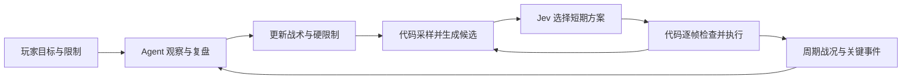

# PvP Agent / Jev 协同设计

状态：设计稿，2026-10-21。本文描述目标接口，不表示已实现。

本轮只写设计。后续先本地实现、测试；只有用户要求上传时才部署服务器。不为 PvPAdventure 增加类型判断、反射、专用网络包或专用战斗规则。

## 1. 目标与当前缺口

目标：AI 是能持续观察、改变打法、管理资源的玩家，能与人交战，而不是调用一次固定射击脚本。

已确认的现状：

- `AgentTools.duel_player` 阻塞至本轮结束，最长 120 秒。Agent 不能在等待期间复盘或修改 strategy。
- `PvpDuel` 给 Jev 移动与近战/远程两个独立问题，各模式只保留第一把可用武器。没有具体武器比较或瞄准策略选择。
- 地形主要是四向余量和钩爪点，不足以表达绕墙、平台出口与开射界。
- 武器禁令只有文本，没有过滤候选；已有 `/swap` 没有 Agent 工具入口。
- 瞄准假设目标当前速度短期延续，外推最多 20 帧。没有行为历史或封路意图。
- Jev 请求间隔受请求耗时和额外等待共同影响，不能将“24 帧”称为实际决策周期。

第一验收目标：人下达武器限制后，AI 在持续交战中能报告受阻原因；Agent 修改打法后，后续 Jev 使用新 instruction，角色继续移动攻击；旧决策不能恢复被禁止的动作。

## 2. 职责与控制权

| 层 | 负责 | 不负责 |
| --- | --- | --- |
| 玩家 | 目标、硬限制、即时覆盖、停止 | 代替 AI 整理背包或逐帧指挥 |
| Agent | 复盘、战术 instruction、武器策略、背包与地形操作、任务持续性 | 每帧算瞄准角或逐键驾驶 |
| Jev | 从有状态依据的候选中选短期移动与攻击方案 | 编造坐标、工具、装备能力或对手未来输入 |
| 代码 | 观测、候选生成、权限与合法性检查、物理计算、执行、事件与统计 | 用固定最高伤害或固定追击规则替代所有战术选择 |

控制优先级：玩家明确限制 > Agent 本任务结构化限制 > Agent 战术偏好 > Jev 短期方案。代码合法性始终检查；Agent 不得放宽玩家硬限制。玩家提出新目标可替换旧目标，不是所有新聊天都自动停止战斗。

每个输入通道只有一个控制持有者。移动、鼠标/武器、方块交互分别仲裁；挖掘或背包换位需要暂停冲突通道，并明确报告暂停原因与恢复条件。

## 3. 同源交战状态

主线程捕获不可变 `CombatFrame`，带 `session_id / tick / captured_at / frame_id / directive_revision`。Agent 和 Jev 从同一数据生成视图，不各自维护另一套事实。单位固定为像素、像素/游戏帧、游戏帧，距离格数仅作可读辅助。

每个推测标记依据、采样时间及置信范围。未知字段用 null 和 unknown_reason，不能填零或伪装成观测。

| 内容 | 必需字段与限制 |
| --- | --- |
| 自身 | 碰撞箱、速度、血量/上限、魔力、影响战斗的状态效果、朝向、地面/液体/钩爪/坐骑状态、物品动画和冷却 |
| 机动 | 当前可用额外跳、剩余飞行资源、可用钩爪目标、装备坐骑及能力来源；不把装备存在等同于当下可用 |
| 对手 | 可观测位置/速度/血量、手持物、朝向和动作状态；对手隐藏资源、未同步装备与背包不推定为已知 |
| 武器资源 | 自己随身武器、槽位、身份、弹药/魔力可用性、使用方式、已知弹道性质、当前可打性、不支持的能力；不只保留两把 |
| 局部地形 | 自己和目标附近的实心砖/平台/液体、遮挡段、可站立区域、钩爪点、可达射击位置；远处可按需扩展查询 |
| 威胁 | 附近实际来弹的身份、位置/速度/尺寸、拥有者、碰撞性质、最近接近时间与估计误差；不声称完整推演模组弹幕 |
| 短时历史 | 最近位置/速度、换向、起跳/落地、已执行移动、射击、切武器、受伤和停火原因 |
| 效果 | 当前窗口的自身/目标 HP 变化、攻击尝试、开火输入与实际生成弹幕分别统计、有效射界时间、受阻与卡住时长 |

目标 HP 变化不等于自己的伤害。没有可靠命中事件时 `confirmed_hits=null`，不得把按住使用或生成弹幕计成命中。

Jev 视图包含当前战术、近期历史、局部几何和可执行候选。Agent 视图包含相同关键事实、数秒窗口摘要、失败证据和工具入口；可请求局部详细图、物品或弹道样本。压缩重复数据，但不省掉决定行为所需的信息。

## 4. Agent 在战斗中的循环



启动战斗后立即返回会话编号。Agent 随后等待短窗口或事件，再观察和调整；等待及 Agent 推理期间，游戏战斗控制器继续执行有效战术。

首轮采用 3 秒周期复盘、最长 5 秒等待返回，作为待测初值。受阻持续、失去可打武器、弹药不足、异常受伤、死亡/复活、目标失效、玩家新限制触发提前返回。事件合并、按序号增量消费，不让每颗弹幕触发 Agent 请求；一个角色只运行一个 Agent 推理轮。

Agent 正文结束不应默认为战斗任务完成。会话仍活动时，宿主在后续事件/周期到来后继续同一任务上下文。API 后端到达已有 40 轮限制时保留任务状态并做结构化摘要续轮；Codex 后端沿用同一线程开启后续 turn。不得开并发 turn，也不得覆盖待处理玩家消息。

停止、新任务、世界卸载和断连递增任务 generation，取消等待、排队工具和在途模型请求。旧回调不得重新启动战斗。自身死亡进入等待复活，不消耗活动战斗预算；复活丢弃旧空间决策后继续。目标死亡按任务结束条件处理。

Agent 暂时失败时：沿用最后有效且未超期的战术，报告故障并有限重试；超期暂停自动攻击/移动，保留会话供恢复。禁止无期限静默使用过期动作。

## 5. 工具契约

以下名称为目标工具，不表示现有接口已可调用。

| 工具 | 输入 | 返回与行为 |
| --- | --- | --- |
| `combat_start` | target、目标/活动时长、初始战术、硬限制 | 立即返回 session、当前 frame、directive revision；不阻塞整轮战斗 |
| `combat_observe` | session、after_event、wait_seconds、detail | 等待至新事件/周期/结束，返回当前 frame、窗口统计、事件序号和结束状态；控制器继续打 |
| `combat_update` | session、expected_revision、战术文本各分区的替换/清除、结构化限制变更 | 原子更新，返回接受/拒绝字段、有效 revision 及冲突原因；不重置目标与活动时长 |
| `combat_stop` | session、reason | 立即释放自动控制、取消在途请求，保留最终摘要 |
| `inventory_swap` | 物品来源、目标槽、预期物品身份 | 主线程校验、换位、联机同步，返回实际前后槽位；动画中忙则报告 busy，不假装完成 |
| 地形工具 | 现有 mine/place/act 参数及受保护区域 | 明确取得通道、限时执行并报告实际变化，再恢复对战；不得两个工具同时改鼠标/手持物 |

`duel_player` 迁移为兼容入口：创建会话、返回首次短窗口报告并指引继续 observe，不再一直阻塞至战斗结束。`fight_player` 的明确原地攻击语义保留。

观察报告应能回答：为什么停火、哪些武器可用、当前动作是否完成、谁在占用通道、下一步能尝试什么，而不是只返回 HP。

## 6. 动态 instruction 与硬限制

`CombatDirective` 分为：

- 玩家原始要求及代码限制：允许/禁止物品身份、允许挖掘/放置、受保护区域、可用消耗物及预算。
- Agent 文本：`general / movement / weapon / aim / terrain / inventory`，支持替换、清除；跨任务默认不延续。
- 版本：session、revision、更新时间、来源；文本有总长度预算，超过预算返回错误，由 Agent 重写，不静默截断。

示例：

```json
{
  "session_id": "combat-7",
  "expected_revision": 3,
  "instructions": {
    "general": "保持中距离消耗，不要为了挥刀追人。",
    "aim": "对手常反向，减少长距离匀速提前量，比较落点和出口。"
  },
  "constraints": {
    "allowed_item_types": [120],
    "allow_mining": false,
    "allow_placing": false
  }
}
```

示例 ID 只是接口示意，实际由物品查询取得，不内置某武器的特殊规则。限制按物品身份执行，换槽仍有效；槽位不是稳定身份。

instruction 在每次 Jev 请求时合成：固定问题定义 + 玩家要求 + 当前 Agent 分区战术。模型不拥有修改该对象的权限。禁止把每轮战术无限追加成历史墙；历史效果另存摘要。

硬限制变更立即作用于执行器，不等待下一次 Jev。软战术更新会废弃旧 revision 的在途判断并触发新请求；短暂沿用仍合法的已有动作，不能恢复已禁止动作。执行当帧再次校验 session、generation、revision、武器身份和空间条件。日志记录修改内容及来源，敏感凭据不进入 instruction。

## 7. Jev 的判断组织

官方接口中同一请求的各问题独立评估，不能读到其他问题答案。因此不采用三个彼此假定对方结果的 move/weapon/aim 问题。

首轮推荐：代码生成有限组联合短期方案，Jev 用一个 Choice 选择 `plan_id`。方案明确关联 `movement_id / weapon_id / aim_id / fire`，包括可选的不射击换位。每个方案提供立即可执行的动作、资源代价、当前/估计射界与威胁；局部终点和对手未来位置必须标为估计。

先过滤硬性不允许与已知不合法方案，再合并等价候选。不能简单对所有移动×武器×瞄准全量笛卡尔积；也不能用面板伤害排序抹掉战术差异。保留接近/撤退/换高度/保持等不同方案、每种可用攻击方式和受阻恢复选项。初始候选预算以请求字节数、候选覆盖率与实测延迟确定，不能先拍一个数量再删掉唯一可行选项。

若联合候选明显膨胀，备选是条件扇出：同一请求问移动，以及“假定选移动 A 时用哪个攻击方案”等条件问题，再取选中移动对应答案。它避免第二次网络往返，但增加问题数量与成本，必须与联合 Choice 做回放对照再选，不先建两套生产框架。

固定问题优先用简洁英文，玩家/Agent 原始中文保留。语言效果按中文与英文场景对照验证；不为每帧翻译额外调用 LLM。

不把 Choice confidence 当安全保证或武器许可。保存原始分布、选中方案、生成与应用时间；独立记录协议/服务失败、过期丢弃、执行拒绝。

## 8. 瞄准、武器与地形

瞄准候选是代码能计算并解释的射击方案，不是随意偏移坐标：当前身体、匀速提前量、依据近期历史的转向备选、可估计落点、平台/掩体出口。没有足够观测就不生成对应预测。

每个候选附预计飞行时间、遮挡、目标运动假设、有效时间和可用武器。Jev 选择意图，代码每帧按该意图重算角度；不能把几百毫秒前的固定鼠标点一直用下去。保留过去取消随机瞄准偏移的决定，封路有明确几何目标。

武器候选覆盖实际可用武器，而非仅 melee/ranged 第一把。区别职业伤害类别与接触/弹幕使用方式；悠悠球、蓄力、回旋镖和鼠标控制武器只有执行能力与状态识别完成后才标为支持。不冒充所有模组通用弹道推演。

射界受阻给 Agent 实际阻挡方块、替代射击位置及可达性证据。Agent 决定换位、等出口或申请挖/放；代码检查挖掘能力、放置规则、玩家保护限制和操作效果。不得未经授权破坏受保护建筑，也不得自动把“对战”解释为允许拆整个地图。

背包管理先提供准确的检查/换位与结果，再逐步加入弹药和装备管理；不让 Agent 通过要求玩家搬走武器来实现禁用。切换/换位后失效旧候选，重新生成。

## 9. 生命周期与并发

会话状态：`active / waiting_for_respawn / paused_for_action / paused_for_model / completed / cancelled`。每次转移有原因、时间和下一恢复条件。

Jev 请求和 Agent 轮次各最多一个在途；任务队列、主线程操作与异步响应统一携带 generation。instruction 更新不需重载。死亡、工具换位、装备能力变化与地形变化后，不能继续使用失效钩点、武器槽或瞄准坐标。

Agent/模型调用使用墙钟预算，移动和活动战斗使用实际游戏帧，等待复活另计；日志同时记录两种时间，避免后台、暂停或加速造成时长混淆。

服务器继续管理所有者、指令路由与共享必要状态；AI 客户端进行观测/推理/本角色控制。多人同步与所有者默认绑定保持通用，不改变 PvPAdventure。

## 10. 实施顺序与验收

| 阶段 | 交付 | 可验证条件 |
| --- | --- | --- |
| 1：指挥闭环 | 共享状态第一版、start/observe/update/stop、宿主续轮、分区 instruction、物品硬限制 | 等待和 Agent 推理时持续战斗；能中途改 instruction 并看到 revision；禁用物品从候选和执行器同时消失；stop 后旧响应不起效；复活继续 |
| 2：信息与选择 | 局部几何、短历史、全武器候选、联合方案、瞄准意图 | 回放解释每个选择及受阻原因；远处不空拿刀；目标换向/落地时比较多个有依据的瞄准候选 |
| 3：环境操作 | inventory_swap、挖掘/放块通道与恢复、资源管理 | 不要求玩家搬走禁用武器；真实槽位变化同步；受保护方块不变；操作完可恢复战斗 |

阶段 1 的最小状态也必须包含双方实时位置/速度/血量、可见手持物、自己可用武器与资源、机动能力、附近来弹、当前射界/阻挡证据、当前动作及最近窗口效果。不得以“后面补信息”为由只给 HP 和坐标。

验证分层：生产逻辑测试权限/版本/事件/任务生命周期；真实引擎对象检查能力和几何接口；真实游戏帧测试输入与动作推进；双客户端测试同步、后台执行及实际手感。前两层通过不能宣称 PvP 水平提高。

保留同一场景回放请求，比较候选覆盖、端到端延迟 p50/p95、过期率、有效攻击时间、受阻恢复时间和硬限制违规次数。命中率只在可靠记录可用时统计。真实 Jev 用于语义场景对照，不能以单次正确返回代替可靠性评估。

第一轮实机脚本：允许弓剑对战 → 中途禁剑并让 Agent 更新瞄准指导 → 躲到掩体后 → AI 死亡复活 → 主动停止。观察硬限制、战术更新、受阻报告、不中断的 Agent 复盘和取消清理。阶段 3 再验收真正挖掘/放块。

## 11. 来源与边界

- 当前实现：`Flow/PvpDuel.cs`、`Flow/PvpTactics.cs`、`Agent/AgentTools.cs`、`Agent/NativeAgent.cs`、`Agent/CodexAgent.cs`、`Agent/Conversation.cs`。
- [TypeSafe State](https://docs.typesafe.ai/concepts/state.md)：结构化 state 与问题独立评估。
- [Parallel questions](https://docs.typesafe.ai/cookbooks/parallel_questions.md)：批量问题的独立性。
- [Speculative fan-out](https://docs.typesafe.ai/patterns/fan-out.md)：条件问题与代码选择适用结果。

本文中的复盘周期、预算和候选组织属于项目设计选择，待测后调整，不是 TypeSafe 的性能保证。
